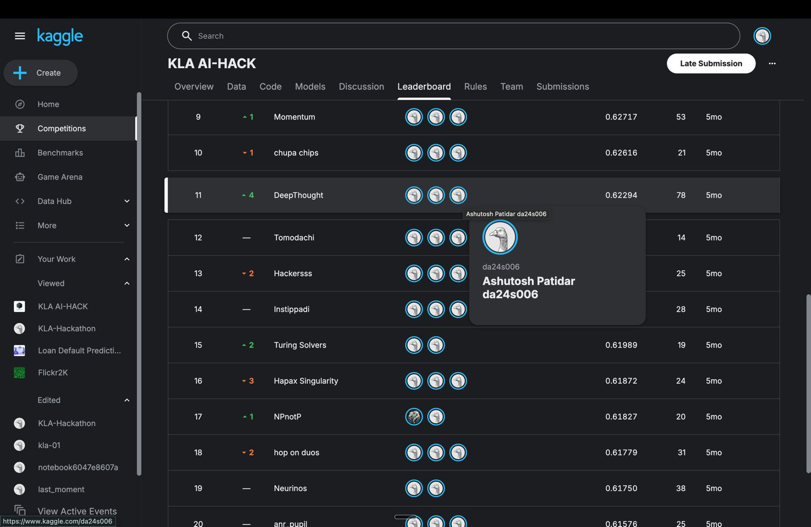

# KLA AI-HACK — Joint Super-Resolution & Denoising

Our solution for the **KLA AI-HACK** Kaggle competition. The task: given a noisy, low-resolution grayscale image, reconstruct the clean high-resolution version (2× upscaling plus denoising in a single step).

Our team **DeepThought** finished **11th on the leaderboard** with a score of **0.62294** over 78 submissions.



## Problem

| | Input (`NoisyLR`) | Target (`GT`) |
|---|---|---|
| Shape | `128 × 128` | `256 × 256` |
| Channels | 1 (grayscale) | 1 (grayscale) |
| Format | `.npy` float arrays in `[0, 1]` | `.npy` float arrays in `[0, 1]` |

- **Train:** 2,400 paired images (`train/NoisyLR`, `train/GT`)
- **Test:** 200 noisy low-res images (`test/NoisyLR`)
- **Submission:** a CSV with columns `id, npy_base64`, where each row is a base64-encoded `.npy` prediction.

## Approach

### Final model: SwinIR ([`final_submited.py`](final_submited.py))

We used **SwinIR**, a Swin-Transformer image restoration network (from [BasicSR](https://github.com/XPixelGroup/BasicSR)), configured for single-channel 2× super-resolution:

- `upscale=2`, `in_chans=1`, `img_size=128`, `window_size=8`
- 6 Residual Swin Transformer Blocks, each with depth 6, 6 heads and embedding dim 180
- `pixelshuffle` upsampler

**Training**
- L1 loss, Adam (`lr=2e-4`), cosine annealing to `1e-6`
- 100 epochs, batch size 8
- Mixed-precision training (`torch.cuda.amp`) to fit the model on one GPU
- Best checkpoint chosen by training PSNR

**Inference:** predictions are clipped to `[0, 1]`, saved as `.npy`, and base64-encoded into `submission.csv`.

### Baseline: EDSR-style ResNet ([`create_notebook.py`](create_notebook.py))

We started from a lightweight residual CNN baseline: 16 residual blocks with 64 features, plus a PixelShuffle 2× upsampler, trained with L1 loss. It runs on Apple Silicon (MPS) or CPU. SwinIR beat it clearly, so we submitted SwinIR.

## Repository structure

```
.
├── final_submited.py        # Final SwinIR training + inference pipeline (generates submission.csv)
├── create_notebook.py       # Generates a notebook with the ResNet baseline (train + predict)
├── create_viz_notebook.py   # Generates a notebook that visualises predictions vs. noisy inputs
├── check.ipynb              # Visualisation notebook: Noisy LR vs. predicted HR side by side
├── inspect_dataset.py       # Quick dataset sanity checks (shapes, dtypes, ranges, scale factor)
└── assets/
    └── leaderboard.jpg      # Final leaderboard screenshot
```

## Getting started

1. **Get the data.** Download the competition data from Kaggle and place it like this:
   ```
   train/GT/*.npy
   train/NoisyLR/*.npy
   test/NoisyLR/*.npy
   ```
   The data is not in this repo because it is too large (about 780 MB).

2. **Install dependencies:**
   ```bash
   pip install torch numpy pandas matplotlib basicsr
   ```

3. **Inspect the dataset (optional):**
   ```bash
   python inspect_dataset.py
   ```

4. **Train and generate the submission:**
   ```bash
   python final_submited.py
   ```
   This writes `best_swinir_model.pth`, the `submission/` folder and `submission.csv`.
   > The script pins the GPU with `CUDA_VISIBLE_DEVICES="3"`. Change this to match your machine.

5. **Visualise the results:** open `check.ipynb` and run the cell to compare noisy inputs with model outputs.

## Team

**DeepThought**: Ashutosh Patidar ([@asu2304](https://github.com/asu2304)) and teammates.
